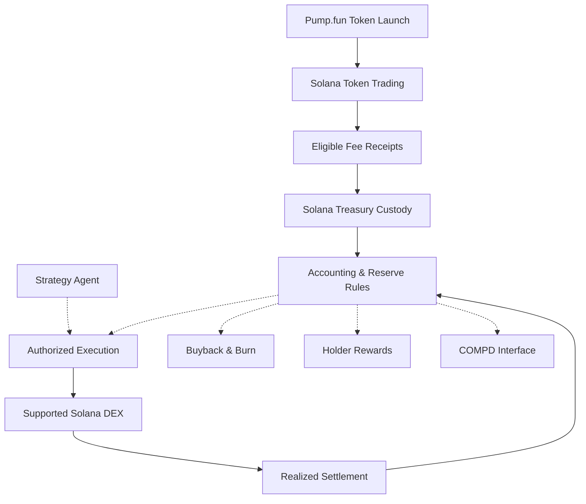
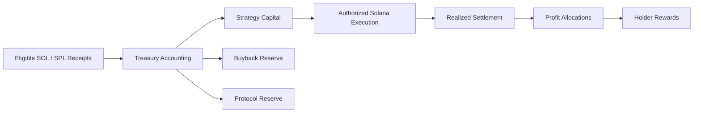

# COMPD — The Compounder

**Supported & Planned Assets**

[Overview](#01-protocol-overview) ·
[Architecture](docs/ARCHITECTURE.md) ·
[Agent](packages/agent) ·
[Smart Contracts](packages/protocol) ·
[Release v0.1.0](https://github.com/CompdProtocol/CompdProtocol/releases/tag/v0.1.0) ·
[Security](SECURITY.md)

Overview · Architecture · Agent · Treasury · Security

COMPD is a Solana focused treasury protocol concept connecting token activity, structured capital allocation, automated strategy infrastructure, buybacks, and holder rewards.

This document describes the target Solana/Pump.fun architecture. The existing verified COMPD deployment and fork evidence concern a different chain; Solana programs, integrations, addresses, and operational status require their own evidence.
01. Protocol Overview
Built to Compound. COMPD brings together three coordinated systems:
- Onchain protocol: treasury custody and accounting, reserve boundaries, settlement, buyback controls, and holder-reward distribution.
- Strategy agent: market monitoring, risk assessment, and execution planning for supported Solana liquidity.
- Protocol interface: treasury activity, strategy history, transactions, and allocation transparency.
COMPD's guiding principle is simple: every eligible inflow should have a defined accounting destination, every strategy outcome should be settled against actual asset movement, and every distribution should follow explicit authorization rules.
02. Pump.fun Token Ecosystem
Pump.fun is the intended token-launch environment for the Solana edition. Token trading, fee eligibility, and any creator-fee receipts depend on Pump.fun's applicable product rules and the token's actual launch configuration.
Layer	Solana edition design
Network	Solana mainnet-beta
Token launch	Pump.fun
Native asset	SOL; wrapped SOL (WSOL) when an integration requires it
Token standard	Solana SPL token / supported token program
Trading liquidity	Supported Solana DEX or routing venue, subject to integration validation
Treasury	Solana-controlled custody and explicit reserve accounting
Rewards	Evidence-backed holder allocations and controlled payouts

Pump.fun creator fees, token fees, liquidity fees, and protocol treasury receipts are not interchangeable. No fixed fee entitlement or automatic treasury funding is implied.
03. System Architecture

The diagram is a target architecture.
04. Solana Program Architecture
A Solana implementation requires native programs and account models rather than a direct rename of EVM contracts.
Component	Responsibility
Treasury program	Custody controls, SOL/SPL balances, reserve accounting
Strategy authority	Restrict permitted execution and capital use
Venue adapters	Integrate with selected Solana swap programs and routes
Settlement	Reconcile principal and realized profit/loss from actual balances
Buyback controller	Govern eligible buyback and burn operations
Holder rewards	Eligibility evidence, liability accounting, and payout controls
Lifecycle controller	Pause, shutdown, termination, and recovery permissions
Indexer/interface	Read program accounts, signatures, events/logs, and balances

Solana programs use program IDs, program-derived addresses (PDAs), account constraints, and Solana transaction semantics. Existing Solidity addresses and EVM contract ABIs cannot serve as Solana deployment evidence.
05. Treasury & Capital Flow
The Solana edition retains COMPD's target economic allocation model, subject to implementation and validation:
Eligible protocol fee receipts
Allocation	Share
Strategy Capital	35%
Buyback Reserve	15%
Protocol Reserve	50%

Positive realized strategy profit
Allocation	Share
Strategy Capital	65%
Buyback Reserve	15%
Holder Rewards	10%
Protocol Reserve	10%

These percentages describe allocation rules for eligible received funds, not a guaranteed percentage of trading volume or Pump.fun fees. Reserve accounting does not itself imply a transfer to an operational/team wallet.

06. Strategy Agent
The strategy agent is designed for recurring observation, risk assessment, and controlled execution on Solana. Venue and asset support must be defined by validated adapters, liquid markets, and independent pricing where applicable.
Strategy workflow
1. Observe eligible Solana markets and pool liquidity.
2. Evaluate price freshness, route quality, execution costs, and risk limits.
3. Propose an authorized strategy action.
4. Execute through a permitted Solana program/venue adapter.
5. Reconcile actual returned assets and realized results.
6. Apply eligible profit allocations only after settlement.
Asset scope: any tokenized-equity strategy, including AMZNx or other xStocks, requires separate verification of token mint, Solana availability, trading venue, and independent reference data. A similarly named asset on another chain is not automatically supported on Solana.
07. Buyback Infrastructure
Buybacks are a distinct treasury operation governed by available reserves, execution authorization, supported Solana liquidity, slippage controls, and token-burn mechanics. A funded reserve does not guarantee an immediate buyback.
08. Holder Rewards
Holder rewards are intended for eligible token holders under evidence-backed distribution rules. Eligibility, snapshot finalization, reserve backing, payout authority, expiry, and recovery must be implemented and verified on Solana before they can be relied upon.

Rewards are dependent on realized positive strategy results; they are not fixed yield, guaranteed distributions, or a deposit/staking product.
09. Protocol Interface
The interface is intended to surface Solana transaction signatures, treasury account balances, strategy activity, buybacks, and reward accounting in a transparent format.

The interface must derive operational claims from real program state and confirmed transactions, not from simulated or cross-chain evidence.
10. Repository & Development
The current COMPD repository structure is a starting reference for the product design:
COMPD/
├── apps/
│   └── interface/
├── packages/
│   ├── agent/
│   └── protocol/
├── docs/
│   └── ARCHITECTURE.md
├── README.md
├── SECURITY.md
└── CONTRIBUTING.md
Solana implementation requires corresponding Solana-native program code, account schemas, RPC/indexer integrations, transaction builders, and tests. Existing EVM/Foundry tests do not certify Solana programs.
11. Network & Verification
Field	Solana edition
Network	Solana mainnet-beta
Launch ecosystem	Pump.fun
Native asset	SOL
Token mint	To be established by the actual Solana launch
Program IDs	To be established by verified Solana deployments
DEX execution	To be selected and validated for supported assets

Verification should cover program IDs, upgrade authorities, PDA/account ownership, SPL mint configuration, transaction signatures, treasury balances, and integration behavior.
12. Security Architecture
COMPD's Solana design emphasizes:
- Treasury isolation: explicit account ownership and reserve segregation.
- Execution authority: restricted signers, program permissions, and strategy limits.
- Settlement integrity: recognize profit only from actual returned value.
- Holder protection: liability backing, eligibility proof, and replay resistance.
- Operational safeguards: pause and terminal recovery rules with documented authorization.
- Integration security: validate Pump.fun interfaces, swap venues, oracle/reference data, and token programs.
Security guarantees depend on implemented and verified Solana programs; they do not carry over automatically from EVM contracts.
13. Protocol Operations
The intended lifecycle connects Pump.fun token activity to eligible treasury receipts, capital allocation, strategy settlement, buybacks, and holder rewards. Each component requires compatible Solana implementation, configuration, and verification.
14. Contributing
See [CONTRIBUTING.md](CONTRIBUTING.md), [SECURITY.md](SECURITY.md), and [ARCHITECTURE.md](docs/ARCHITECTURE.md). These existing repository links may still describe the original implementation until the corresponding Solana documentation is updated.
15. Licensing
No first-party root license is established by this document. Public availability of code does not by itself grant redistribution rights; third-party components retain their respective licenses.
