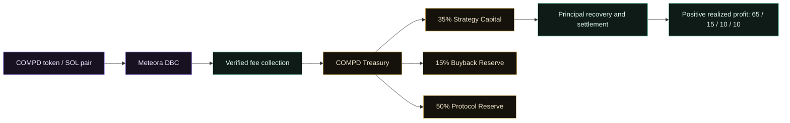

# COMPD — The Compounder

**Built to Compound.**

Treasury discipline. Defined capital flows. A framework for compounding realized results.

[Vision](#01--the-compd-vision) · [Economics](#03--two-financial-flows-one-treasury) · [Agent](#04--autonomous-strategy-agent) · [Architecture](#08--architecture) · [Ecosystem](#09--solana-mainnet-and-meteora-dbc) · [Documentation](#10--repositories-and-documentation)

---

## 01 · The COMPD vision

COMPD is a Solana-native protocol for modular treasury accounting and bounded execution on **Solana Mainnet**, with **Meteora Dynamic Bonding Curve (DBC) selected as its launch platform**. Its purpose is to give capital a defined lifecycle: receive, account, allocate, execute and reconcile.

The selected trading pair is **COMPD / SOL**. The core concept is disciplined reinvestment. Eligible protocol revenue supports strategy capital and dedicated reserves. Positive realized strategy results can replenish capital, support buybacks and fund holder rewards under explicit allocation rules.

Compounding is a design objective, not an assumed outcome. The system records losses as well as gains and separates the authority to move assets from the decision to propose a strategy.

Three principles shape the protocol:

- **Separate the responsibilities.** Treasury custody, strategy execution, settlement and distribution have distinct boundaries.
- **Reconcile before allocating profit.** A reported return or an unrealized price increase is not settled value.
- **Make capital use explicit.** Strategy capital, principal and dedicated reserves remain identifiable in accounting.

## 02 · How the protocol works

The Solana design connects treasury accounting with a controlled strategy lifecycle. The responsibilities below describe the target architecture, not deployed Solana programs.

1. **Receive and classify.** Eligible native-asset inflows enter the Kernel and are recorded according to their funding category.
2. **Allocate within limits.** Available strategy capital can support admitted strategy runs, subject to lifecycle, exposure and permission checks.
3. **Execute through defined boundaries.** StrategyExecutor dispatches to approved adapters rather than granting an Agent unrestricted treasury access.
4. **Recover and reconcile.** Settlement coordinates exit, collection and closure. Physical returns are checked against the run's principal and recovery records.
5. **Allocate realized results.** Positive profit replenishes strategy capital and dedicated reserves; losses reduce strategy capital and may halt further allocation.
6. **Process reserves separately.** Buyback and holder-payment paths apply their own authorization, evidence and accounting controls.

These mechanics describe the intended Solana operating model. **Deployment and Agent execution will follow implementation qualification.** Historical implementation details are retained in the linked technical records.

## 03 · Two Financial Flows. One Treasury.

COMPD distinguishes revenue entering the protocol from profit earned by a strategy. Both contribute to one treasury framework, but they follow different rules and remain separately accounted for.

A treasury bucket is an accounting designation. Crediting a reserve does not itself send tokens to holders, execute a buyback or transfer funds to an operator.

### Flow I — Trading fee allocation

The recurring revenue model allocates **eligible revenue actually received by the COMPD treasury** as follows:

| Destination | Allocation | Purpose |
|---|---:|---|
| Strategy Capital | **35%** | Increase capital available for eligible strategy activity |
| Buyback Reserve | **15%** | Accumulate a dedicated budget for authorized buyback operations |
| Protocol Reserve | **50%** | Record the protocol's designated reserve share |

For every 100 units of eligible receipts, 35 are accounted to strategy capital, 15 to the buyback reserve and 50 to the protocol reserve.

This split applies to receipts recognized by the protocol, not to all market trading volume. It does not establish a fee entitlement from any external venue, including Meteora DBC.

### Flow II — Positive realized strategy profit

After a run is closed and physically returned assets are reconciled against its principal, **positive realized profit** is allocated as follows:

| Destination | Allocation | Purpose |
|---|---:|---|
| Strategy Capital | **65%** | Retain the majority of realized profit for future eligible strategies |
| Buyback Reserve | **15%** | Add to the dedicated buyback budget |
| Holder Rewards | **10%** | Credit the reserve supporting eligible holder distributions |
| Protocol Reserve | **10%** | Credit the protocol reserve |

For 100 units of positive realized profit, 65 remain in strategy capital, 15 support buybacks, 10 support holder rewards and 10 enter the protocol reserve.

Returned principal is reconciled separately; it is not counted as profit. Unrealized gains do not trigger this split. The Solana implementation must conserve totals under integer rounding, including any remainder.

### Funding is not revenue

Bootstrap funding retains a separate design rule: **10% strategy capital / 90% treasury principal**. Keeping this category distinct prevents the recurring revenue split from being applied to initial principal.

Together, these rules give each funding category a defined destination without treating every inflow as distributable profit.

## 04 · Autonomous Strategy Agent

The Agent design combines recurring observation, risk assessment and execution planning. Its role is to evaluate opportunities within protocol limits, while contracts retain control of custody and permitted asset movement.

### An eight-hour decision rhythm

The Agent design retains evaluation and lifecycle planning on **8-hour UTC cycles**. A cycle provides a decision window; it does not require a trade or promise a holding period.

The intended sequence is:

1. Observe market inputs, available capital and the current protocol lifecycle.
2. Check data freshness, price references, liquidity and eligible routes.
3. Evaluate a strategy proposal against capital and risk limits.
4. Produce a bounded plan, or remain idle when requirements are not met.
5. Recheck permission and lifecycle conditions before any authorized action.
6. Record observations and reconcile subsequent lifecycle evidence.

Solana strategy assets, venues and price references require fresh qualification. Historical EVM xStocks and PancakeSwap routes do not establish Solana asset support or execution permission.

The Solana Agent will begin with observation and simulation. Autonomous execution requires separately implemented custody controls, qualified venues and explicit activation; this README does not enable it.

## 05 · Capital preservation and execution safeguards

Capital preservation begins with limiting what can be put at risk and recognizing when new allocation must stop.

| Control | Design purpose |
|---|---|
| Segregated accounting | Distinguish strategy capital, treasury principal and purpose-specific reserves |
| Allocation ceilings | Bound individual runs, aggregate exposure and concurrent activity |
| Adapter admission | Restrict execution to admitted strategy components |
| Runtime identity checks | Check component code identity at defined execution boundaries |
| Input qualification | Reject stale or incomplete observations and unqualified routes |
| Lifecycle gates | Restrict new risk during paused, recovery or terminal states |
| Physical-return settlement | Reconcile reported outcomes against actual returned native assets |
| Evidence and replay controls | Bind actions and payments to their recorded identities and status |

The target risk model retains **10% of strategy capital per run**, **30% aggregate allocation**, and **three concurrent runs**. These limits must be implemented and tested on Solana; historical EVM controls are not evidence of Solana enforcement.

These controls constrain execution. They do not eliminate market loss, liquidity risk or integration failure. See the [security policy](SECURITY.md) for the wider review boundaries.

## 06 · Buyback mechanics

The buyback reserve receives allocations from both eligible revenue and positive realized strategy profit. This separates the accumulation of a budget from the decision to spend it.

The intended operating sequence is:

1. Credit the dedicated reserve through the relevant accounting flow.
2. Check activation, lifecycle state, available reserve and per-action limits.
3. Validate the authorized execution route and its required evidence.
4. Execute a bounded purchase through the Kernel-bound buyback executor.
5. Record the outcome separately from any intended token-burn step.

A funded reserve does not imply immediate execution. A buyback and a burn are distinct outcomes: neither should be inferred from reserve growth alone.

The Solana buyback design requires a qualified purchase route, explicit spending controls and a verified token-burn path. Meteora DBC launch selection alone does not activate COMPD buybacks.

## 07 · Passive holder rewards

The holder-reward design gives eligible holders a defined share of **positive realized strategy profit** through the 10% reward allocation.

Here, *passive* describes the intended holder experience: rewards arise from protocol accounting rather than the holder operating a strategy. Eligibility and payment remain governed by the distribution rules.

The reward workflow separates:

- **Reserve funding:** credit the holder-reward share after positive-profit settlement.
- **Eligibility review:** bind a distribution window to candidate and canonical evidence.
- **Finalization:** establish the distribution and its associated liabilities.
- **Payment:** apply fixed-recipient evidence, reserve checks and payment status.
- **Recovery:** handle failed payments and retries without treating failure as successful distribution.

A reward allocation is not an immediate payout. Rewards are variable and conditional on realized results, eligible evidence and authorized processing; there is no fixed yield or guaranteed distribution.

## 08 · Architecture

The diagram describes the **target Solana responsibility model**. Historical Solidity contracts remain EVM source and are not Solana programs.

The flow describes intended responsibilities and allocation rules; verified fee collection will bind actual pool receipts to the treasury before allocation. The Agent proposes bounded actions; the interface presents observations. Neither replaces the Kernel's permissions or settlement checks.

The architecture keeps custody and accounting central while giving execution, buyback policy and holder processing their own responsibilities. See the [architecture reference](docs/ARCHITECTURE.md) for repository boundaries and [Kernel source](packages/protocol/contract/production/v3/phase7cr2ch/CompdVaultKernelV3.sol) for the historical EVM accounting implementation, not deployed Solana programs.

## 09 · Solana Mainnet and Meteora DBC

**Solana Mainnet is COMPD's selected target blockchain. Meteora DBC is the selected token launch platform.** The transition carries forward COMPD's treasury discipline and separate financial flows.

The black-and-gold identity remains central, with restrained violet and mint accents. The launch transition does not change the chain or execution model of the preserved historical contracts.

Implementation work must establish native program architecture, custody and authority boundaries, verified DBC fee receipts, supported venues and distribution evidence.

Platform selection is confirmed; operational integration is not. No Solana token mint, COMPD program deployment, live trading or active reward service is established by this document. No Meteora DBC partnership or guaranteed fee entitlement is implied.

## 10 · Repositories and documentation

### Project repositories

| Repository | Focus | Access |
|---|---|---|
| [CompdProtocol](https://github.com/CompdProtocol/CompdProtocol) | Public project presentation and existing source snapshot | Public |
| [compd-protocol](https://github.com/CompdProtocol/compd-protocol) | Historical EVM contracts, Foundry tests, ABI exports and recorded evidence | Private |
| [compd-interface](https://github.com/CompdProtocol/compd-interface) | Standalone frontend, observation panels and evidence-review interface | Private |

Private repository links require authorized access. The existing public snapshot retains its own repository layout and documentation.

### Technical references

- [Architecture and trust boundaries](docs/ARCHITECTURE.md)
- [Protocol implementation and development](packages/protocol/README.md)
- [Frontend setup and development](apps/README.md)
- [Observation API contract](apps/API-CONTRACT.md)
- [Security policy and responsible disclosure](SECURITY.md)
- [Historical EVM deployment evidence](packages/protocol/docs/deployment-addresses.json)
- [Third-party provenance and licensing](packages/protocol/THIRD_PARTY_NOTICES.md)
- [Release v0.1.0](https://github.com/CompdProtocol/CompdProtocol/releases/tag/v0.1.0)
- [Contribution guidance](CONTRIBUTING.md)

[Snapshot validation and packaging limits](docs/PUBLIC-SNAPSHOT-NOTES.md) complement these references. No completed independent audit, production readiness or trading performance is claimed here.

COMPD first-party licensing awaits owner approval. Third-party components retain their applicable terms; public source availability does not itself grant unrestricted reuse.

---

**COMPD — The Compounder** · **Built to Compound.**
