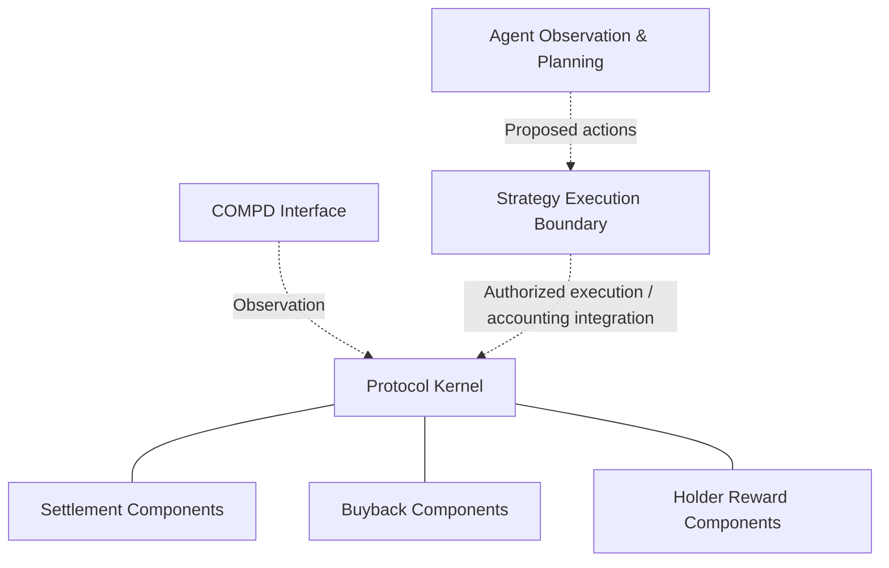

# COMPD — The Compounder


**Built to Compound.**

COMPD is a modular treasury and strategy execution framework developed for BNB Chain. It brings protocol accounting, controlled execution, strategy evaluation, buyback mechanisms, and holder reward infrastructure into a connected development architecture.

The project is designed around a fundamental separation of responsibilities: treasury accounting defines how capital is recorded and allocated, execution components handle authorized strategy operations, and settlement mechanisms reconcile strategy outcomes with protocol accounting.

COMPD combines Solidity smart contracts, an observation and planning layer, and a web interface to support development, testing, and protocol transparency.

> **Development status:** COMPD remains under active development. The presence of source code, tests, and deployment artifacts does not establish production readiness. Agent trading is not currently live.

---

## 01. Protocol Overview

COMPD explores a modular approach to treasury management in which strategy execution and protocol accounting operate through defined boundaries.

Rather than treating a trading strategy as the entire protocol, COMPD separates several responsibilities:

- **Treasury Accounting** — tracks protocol capital, reserves, and accounting states.
- **Strategy Execution** — provides a controlled pathway for strategy-related operations.
- **Settlement** — reconciles completed strategy outcomes with protocol accounting.
- **Buyback Infrastructure** — supports protocol-defined buyback operations.
- **Holder Rewards** — provides dedicated reward accounting and distribution components.
- **Observation & Planning** — evaluates available data and prepares potential strategy actions.
- **Protocol Interface** — presents protocol information and available monitoring data.

These components form the foundation for an extensible treasury framework. Their existence in source does not imply that every integration is operational or independently validated.

## 02. System Architecture

COMPD is organized into three principal software layers: the interface, the agent system, and the on-chain protocol.

| Layer | Responsibility | Technology |
|---|---|---|
| Interface | Protocol presentation, monitoring, and dashboard functionality | Web frontend |
| Agent | Observation, evaluation, and strategy planning | Python-based tooling |
| Protocol | Treasury accounting, execution controls, settlement, and rewards | Solidity / BNB Chain |

### Architecture overview



The diagram illustrates the architectural responsibilities of the system. It is not a claim that every connection represents a currently active production integration.

### Separation of responsibilities

The interface is not an authoritative source of on-chain financial state. Agent observations and proposed actions do not automatically become executable transactions. The protocol's accounting rules and authorization boundaries remain distinct from off-chain evaluation.

This separation is important for preserving clarity between observed information, proposed execution, actual asset movement, and recorded financial outcomes.

## 03. Smart Contract Architecture

COMPD's protocol layer contains Solidity components addressing treasury management, strategy execution, settlement, and protocol-level financial operations.

### Core modules

| Module | Primary responsibility |
|---|---|
| Kernel | Coordinates protocol accounting, reserve separation, and lifecycle controls |
| StrategyExecutor | Provides the strategy execution boundary and integration path |
| Settlement | Accounts for completed strategy outcomes and realized financial results |
| Treasury Components | Manage protocol-defined capital accounting and allocation responsibilities |
| Buyback Components | Support buyback operations under applicable protocol rules |
| Holder Reward Components | Support reward accounting and distribution workflows |
| Interfaces & Adapters | Define integration boundaries between contracts and external systems |

### Kernel

The Kernel is a central component of COMPD's protocol accounting architecture.

Its responsibilities include maintaining the separation between treasury accounting and strategy-related activity, coordinating relevant lifecycle transitions, and providing accounting boundaries for connected protocol components.

The Kernel should not be interpreted as an unrestricted trading wallet or a guarantee of automated financial returns.

### StrategyExecutor

StrategyExecutor provides a dedicated boundary for strategy-related execution.

Its architectural purpose is to keep execution responsibilities distinct from higher-level treasury accounting and off-chain strategy evaluation.

A proposed strategy action is not equivalent to an executed trade. Authorization, adapter compatibility, execution conditions, and actual transaction outcomes must be verified independently.

### Settlement

Settlement components address the reconciliation of strategy activity with protocol accounting.

An important distinction is maintained between:

- An estimated or observed strategy result.
- An executed transaction.
- Assets physically returned or transferred.
- A realized outcome recognized by protocol accounting.

This distinction is essential for preventing hypothetical or unrealized performance from being presented as settled protocol profit.

## 04. Treasury & Capital Management

COMPD separates capital accounting from the execution of individual strategies.

The treasury architecture is intended to support explicit financial responsibilities, rather than treating all available capital as unrestricted strategy liquidity.

### Capital lifecycle

A high-level strategy lifecycle can be described as:

1. Capital is accounted for within the relevant treasury and reserve framework.
2. A strategy operation is evaluated against its applicable authorization and execution requirements.
3. An approved execution path may interact with external liquidity or strategy infrastructure.
4. Completed execution results and physical asset movements are evaluated for settlement.
5. Recognized outcomes are processed through the applicable protocol accounting rules.
6. Subsequent treasury, buyback, or holder-reward operations remain subject to their respective mechanisms.

This describes the conceptual lifecycle, not a guarantee that all stages are enabled or operational in the current development environment.

### Accounting versus asset movement

COMPD distinguishes internal accounting updates from actual blockchain asset transfers.

An accounting entry alone does not establish that assets have moved, a trade has succeeded, or profit has been realized.

Financial state should be verified against relevant contract behavior, transaction evidence, and the intended deployment environment.

## 05. Strategy Execution & Settlement

COMPD separates strategy planning from execution and settlement.

**Observation:** Off-chain systems evaluate available information and market conditions.

**Planning:** Strategy logic may construct proposed actions using its configured rules.

**Execution:** Any transaction-capable pathway must satisfy the applicable authorization, adapter, and operational requirements.

**Settlement:** Completed outcomes are reconciled with the protocol's financial accounting model.

### Realized profit

COMPD's accounting design distinguishes realized strategy outcomes from estimated portfolio changes or unrealized market movements.

Profit-related protocol operations must rely on the settlement rules implemented by the relevant contracts.

The availability of settlement code does not establish that live strategies are generating profit.

### Execution status

Agent trading is currently **not live**.

Strategy adapters, risk controls, data freshness, external market dependencies, and end-to-end settlement behavior require appropriate validation before production execution can be considered.

## 06. Buyback & Holder Rewards

COMPD includes separate protocol components for buyback-related activity and holder reward accounting.

### Buyback infrastructure

Buyback components provide a dedicated mechanism for protocol-defined buyback operations.

Actual buyback eligibility, funding, execution, and accounting depend on the implementation and applicable operational configuration.

The presence of a buyback contract does not imply that automatic buybacks are currently active.

### Holder reward infrastructure

Holder reward components address the accounting and distribution of protocol-defined rewards.

Their purpose is to separate holder-related distribution responsibilities from strategy execution and treasury bookkeeping.

Reward availability, eligibility, calculation, and claiming depend on the relevant implementation and deployed configuration.

**No fixed yield, guaranteed return, or active distribution schedule is implied by this repository.**

## 07. Interface & Agent Systems

### Interface

Location: `apps/interface/`

The COMPD interface provides a frontend for exploring protocol-related information and supported observation features.

Its development scope includes:

- Protocol presentation and dashboard views.
- Observation and transaction-evidence interfaces.
- Frontend integration and testing.
- Local development workflows.

Displayed information must be interpreted according to its actual source. Simulated, cached, fixture-based, and live blockchain data are not interchangeable.

### Agent

Location: `packages/agent/`

The agent component contains software for observation, evaluation, planning, and supporting tests.

Agent-generated outputs should be treated as proposed decisions or analytical results unless execution is independently verified.

The presence of agent software does not establish autonomous production trading, validated strategy performance, or unrestricted transaction authority.

## 08. Repository Structure

```text
COMPD/
├── apps/
│   └── interface/
│       └── README.md
├── packages/
│   ├── agent/
│   │   └── README.md
│   └── protocol/
│       └── README.md
├── docs/
│   └── ARCHITECTURE.md
├── README.md
├── SECURITY.md
└── CONTRIBUTING.md
```

Each component maintains its own development tooling and documentation.

Additional files and directories are described in the relevant component README.

## 09. Getting Started

COMPD supports component-level development workflows.

### Prerequisites

| Component | Requirements |
|---|---|
| Interface | Node.js 20+, npm |
| Agent | Python 3.12+ |
| Protocol | Foundry, Node.js/npm and declared project dependencies |

### Interface development

```bash
cd apps/interface
npm ci
npm run check
npm test
npm run build
npm run dev
```

The development server prints the local address where the interface can be accessed.

See [Interface Documentation](apps/interface/README.md).

### Agent testing

```bash
cd packages/agent
python -m unittest discover -s tools/agent-scheduler -p test_dashboard_api.py
python -m unittest discover -s tools/agent-scheduler -p test_xstocks_agent.py
```

Some tests or integrations may require additional dependencies or local configuration.

See [Agent Documentation](packages/agent/README.md).

### Protocol development

```bash
cd packages/protocol
npm install
npm run build
npm test
```

These commands require the project dependencies and Foundry tooling.

See [Protocol Documentation](packages/protocol/README.md).

Do not run transaction-broadcasting or deployment scripts without separately reviewing their configuration, permissions, and effects.

## 10. Testing & Verification

COMPD includes development and testing infrastructure across its component repositories.

Testing serves different purposes depending on the layer:

| Area | Verification objective |
|---|---|
| Smart Contracts | Contract behavior, accounting rules, and relevant execution boundaries |
| Interface | Frontend behavior, integration assumptions, and build correctness |
| Agent | Observation, planning, fixtures, and regression behavior |
| Integration | Compatibility and consistency across connected components |
| Deployment | Address, runtime bytecode, permissions, and configuration verification |

A successful build or unit test does not prove the complete system is secure or production-ready.

Deployment qualification and integration validation are separate from source-level correctness.

## 11. Network & Deployment

COMPD's protocol development targets **BNB Smart Chain (chain ID 56)**.

Contract addresses, deployment artifacts, and ABI files must be evaluated against the intended network and deployment context.

Before relying on any deployed component, verify:

- The target chain and contract address.
- Deployed runtime bytecode and relevant proxy configuration.
- Privileged roles and administrative permissions.
- Dependencies and connected contract addresses.
- Treasury and strategy configuration.
- Relevant transaction and deployment evidence.

A documented address or generated ABI is not sufficient evidence that a complete protocol deployment is operational.

## 12. Security Considerations

COMPD includes financial accounting and execution-related components. Such systems require careful review of authorization, asset custody, external dependencies, and state transitions.

Relevant security considerations include:

- **Access Control:** Privileged functions and execution permissions.
- **Treasury Integrity:** Separation of accounting state, reserves, and physical asset movements.
- **Execution Risk:** External integrations, transaction outcomes, and adapter behavior.
- **Settlement Integrity:** Reconciliation of realized outcomes with accounting state.
- **Data Reliability:** Freshness and independence of information used by strategy systems.
- **Operational Security:** Signing credentials, deployment configuration, and infrastructure permissions.

Public source availability and automated tests do not constitute an independent security audit.

COMPD is not represented as independently audited or production-qualified.

Review [Security Policy](SECURITY.md) before interacting with contract deployment or execution tooling.

## 13. Development Status

COMPD remains under active development.

| Area | Status |
|---|---|
| Protocol source | Available in the development codebase |
| Smart contract tests | Included in the development tooling |
| Interface | Development implementation available |
| Agent observation and planning | Development implementation available |
| Live Agent trading | Not enabled |
| Independent security audit | Not claimed |
| End-to-end production qualification | Not established |

Implementation, testing, deployment, and production readiness are separate milestones.

No financial performance, guaranteed compounding outcome, or operational profitability is represented by this documentation.

## 14. Contributing

Contributions should follow the repository's development and security guidelines.

Before submitting changes, review:

- [Contributing Guidelines](CONTRIBUTING.md)
- [Security Policy](SECURITY.md)
- [Architecture Documentation](docs/ARCHITECTURE.md)

Changes affecting financial accounting, execution permissions, or settlement behavior should include appropriate testing and technical justification.

## 15. Licensing

No root first-party license is currently provided.

Unless an applicable license is explicitly granted, the public availability of COMPD source code does not automatically grant permission to reproduce, modify, or redistribute its first-party implementation.

Third-party dependencies and bundled components remain subject to their respective licenses and attribution requirements.

---

**COMPD — The Compounder**

*Built to Compound.*
