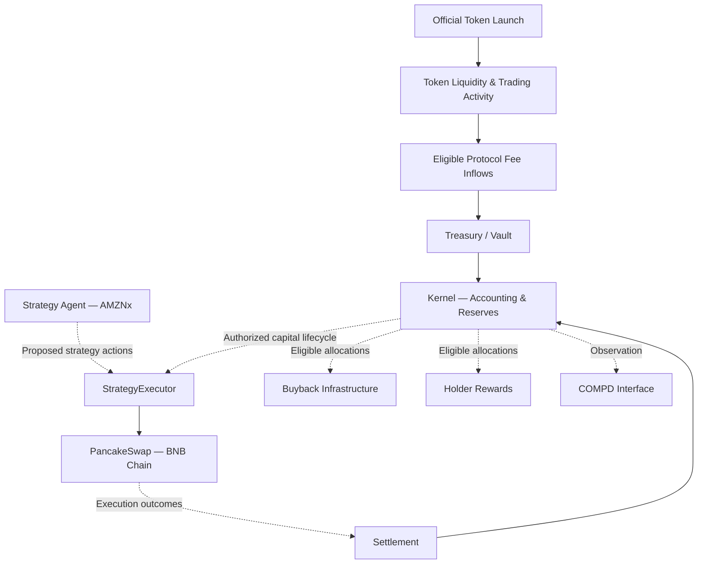
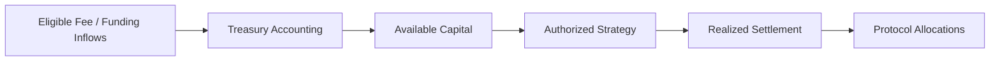

# COMPD — The Compounder
[](https://github.com/CompdProtocol)
[](https://www.bnbchain.org/)
[](https://github.com/CompdProtocol)
[](https://pancakeswap.finance/)

**Supported & Planned Assets**

[](https://github.com/CompdProtocol)


[Overview](#01-protocol-overview) ·
[Architecture](docs/ARCHITECTURE.md) ·
[Agent](packages/agent) ·
[Smart Contracts](packages/protocol) ·
[Release v0.1.0](https://github.com/CompdProtocol/CompdProtocol/releases/tag/v0.1.0) ·
[Security](SECURITY.md)


**Built to Compound.**

COMPD is a treasury-driven protocol on BNB Chain, connecting token activity, on-chain capital allocation, autonomous strategy infrastructure, buyback mechanisms, and holder rewards within a unified financial architecture.

The protocol is designed to convert eligible treasury inflows into structured capital operations, with execution, settlement, and allocation governed by dedicated on-chain components.

COMPD brings together three primary systems:

- **On-Chain Protocol** — treasury accounting, strategy execution boundaries, settlement, buyback, and holder reward infrastructure.
- **Strategy Agent** — market observation, risk evaluation, and strategy planning for supported assets.
- **Protocol Interface** — visibility into treasury activity, transaction evidence, strategy operations, and protocol accounting.

The initial trading integration is focused on **AMZNx**, a tokenized equity asset, through supported PancakeSwap liquidity on BNB Chain.

## 01. Protocol Overview

COMPD is built around a simple principle: capital entering the protocol should be accounted for, allocated according to defined rules, and reconciled against verifiable on-chain activity.

The protocol separates financial responsibilities into distinct components rather than relying on a single unrestricted treasury wallet.

Its architecture covers treasury accounting, strategy execution, realized-profit settlement, buyback operations, and holder reward distribution.

### Protocol operating model

COMPD is designed to operate through a connected financial lifecycle:

1. **Token activity** — trading activity and applicable token fee mechanisms generate eligible protocol inflows.
2. **Treasury funding** — eligible assets are received and accounted for through the protocol's treasury infrastructure.
3. **Capital allocation** — available capital is separated according to applicable reserve and strategy rules.
4. **Strategy execution** — authorized execution infrastructure interacts with supported liquidity.
5. **Settlement** — completed strategy outcomes are reconciled against actual asset movements.
6. **Protocol allocation** — eligible realized results are processed through the applicable buyback, reserve, and holder reward mechanisms.

The lifecycle depends on the relevant contracts, liquidity, funding, execution permissions, and operational conditions.

## 02. Launch Activation

COMPD's operational lifecycle is intended to begin following the official token launch and completion of the necessary on-chain prerequisites.

### Activation requirements

| Requirement | Purpose |
|---|---|
| Official token launch | Establishes the protocol's token ecosystem |
| Token liquidity | Supports on-chain token trading |
| On-chain transaction activity | Generates activity relevant to applicable fee mechanisms |
| Fee collection | Provides eligible inflows under the token's actual fee configuration |
| Treasury / vault funding | Establishes available protocol capital |
| Contract configuration | Connects authorized protocol components |
| Strategy validation | Confirms execution and settlement conditions for the supported trading integration |

Token launch and liquidity alone do not automatically guarantee strategy execution. The required contracts, integrations, capital availability, and risk controls must also satisfy their operating conditions.

### Capital activation

Treasury capital is not assumed to exist simply because the token has launched.

The applicable fee and funding mechanisms must actually deliver assets to the designated treasury or vault infrastructure before those assets can be considered available for allocation.

COMPD's accounting architecture distinguishes available capital, reserved capital, and realized strategy outcomes.

## 03. System Architecture

COMPD separates user-facing observation, off-chain strategy decisions, and on-chain financial operations.



This diagram represents the intended protocol lifecycle. Actual asset movements and allocation paths are determined by deployed contracts and verified execution behavior.

## 04. Smart Contract Architecture

COMPD's on-chain architecture is organized around accounting integrity, controlled execution, and separation of financial responsibilities.

| Component | Responsibility |
|---|---|
| Kernel | Treasury accounting, reserve separation, and protocol lifecycle coordination |
| StrategyExecutor | Authorized strategy execution boundary |
| Strategy Adapters | Integration with supported execution venues |
| Settlement Components | Reconciliation of completed strategy outcomes and realized results |
| Treasury / Vault Components | Receipt, custody, and accounting of eligible protocol capital |
| Buyback Components | Execution and accounting for applicable buyback operations |
| Holder Reward Components | Reward accounting, eligibility, and distribution workflows |
| Protocol Interfaces | Contract-level integration and permission boundaries |

### Kernel

The Kernel coordinates the accounting responsibilities of the protocol.

Its role is to maintain the distinction between treasury capital, strategy-related accounting, and other protocol allocations.

The Kernel's financial state must be interpreted according to actual contract transitions and asset movements.

### StrategyExecutor

StrategyExecutor defines the on-chain execution boundary for authorized strategy operations.

It is separate from the Agent's observation and planning processes.

An Agent decision does not independently establish execution authority. Transactions remain subject to the relevant execution permissions and contract-level requirements.

### Settlement

COMPD distinguishes realized strategy outcomes from unrealized changes in market value.

Settlement is intended to reconcile completed strategy activity with actual capital movements before applicable profit-related allocations are recognized.

This separation is fundamental to the protocol's accounting model.

## 05. Treasury & Capital Flow

COMPD's treasury infrastructure is designed to receive eligible protocol inflows and account for them through defined capital categories.

### Treasury responsibilities

- Record eligible capital entering the protocol.
- Maintain relevant reserve and allocation boundaries.
- Track capital committed to authorized strategy activity.
- Reconcile returned capital and realized outcomes.
- Support downstream protocol operations under their applicable rules.

### Capital lifecycle



Accounting entries are not equivalent to physical token transfers. All capital movement and settlement must be evaluated against actual contract behavior and transaction evidence.

## 06. Initial Trading Strategy — AMZNx

COMPD's initial Agent trading scope is focused on **AMZNx**, using compatible PancakeSwap liquidity on BNB Chain.

The initial scope is intentionally narrow, allowing the execution and risk framework to be evaluated against a specific supported asset before considering additional integrations.

### Initial execution scope

| Parameter | Initial scope |
|---|---|
| Trading asset | AMZNx |
| Network | BNB Chain |
| Execution venue | PancakeSwap |
| Integration approach | V3-compatible strategy adapter |
| Capital and routing asset | BNB / WBNB where required |
| Strategy lifecycle | Observation → Risk Evaluation → Execution → Settlement |
| Expansion | Additional assets require separate integration and validation |

BNB and WBNB serve capital and execution-routing responsibilities; they do not redefine the initial strategy as unrestricted cryptocurrency trading.

### Strategy workflow

**1. Market observation**

The Agent evaluates available market information relevant to AMZNx, including supported on-chain liquidity and independent reference data.

**2. Risk evaluation**

Proposed actions are assessed against applicable execution conditions, market-data freshness, liquidity constraints, and operational safeguards.

**3. Strategy planning**

The Agent constructs a potential execution decision based on the supported strategy configuration.

**4. Authorized execution**

Eligible actions may be submitted through the configured execution boundary and compatible adapter.

**5. Settlement**

Completed execution results are reconciled through the protocol's settlement and accounting components.

### Market-data considerations

Tokenized equity trading introduces dependencies beyond ordinary cryptocurrency swaps.

Execution safeguards must account for reliable independent reference pricing, stale data, market availability, and relevant trading restrictions.

A functioning DEX pool alone does not establish that the underlying asset can be traded safely under all market conditions.

## 07. Buyback Infrastructure

COMPD includes dedicated infrastructure for protocol-defined buyback operations.

Buyback activity is separate from strategy planning and treasury accounting, with its own applicable funding, authorization, and execution requirements.

The availability of treasury capital or positive strategy performance does not independently guarantee that a buyback will occur.

Actual buyback execution depends on the governing contract rules, available funds, and operational configuration.

## 08. Holder Rewards

COMPD includes holder reward infrastructure intended to account for and distribute eligible protocol allocations.

Reward-related operations are separated from strategy execution to maintain clear financial responsibilities.

### Reward lifecycle

1. An eligible allocation is recognized under the applicable protocol rules.
2. The corresponding reward accounting or distribution mechanism processes that allocation.
3. Holder eligibility is determined using the implemented rules and relevant data.
4. Rewards become distributable or claimable according to the configured mechanism.

Holder rewards depend on actual protocol activity and applicable allocations. They do not represent a fixed yield or guaranteed return.

## 09. Interface & Agent Systems

### Protocol Interface

`apps/interface/`

The COMPD interface provides a user-facing layer for exploring protocol information, treasury-related observations, and available transaction evidence.

Its responsibilities include protocol presentation, dashboard views, monitoring integrations, and local development tooling.

### Strategy Agent

`packages/agent/`

The Agent system supports observation, risk evaluation, and strategy planning for the supported trading scope.

Its responsibilities remain distinct from the authority of on-chain execution contracts.

A proposed action, simulated result, or dashboard observation should not be interpreted as a completed blockchain transaction without corresponding execution evidence.

## 10. Repository Structure

```text
COMPD/
├── apps/
│   └── interface/
├── packages/
│   ├── agent/
│   └── protocol/
├── docs/
│   └── ARCHITECTURE.md
├── README.md
├── SECURITY.md
└── CONTRIBUTING.md
```

The repository organizes interface, Agent, protocol, and supporting documentation into separate component directories.

Private operational credentials, deployment secrets, and runtime infrastructure are not part of the public documentation.

## 11. Getting Started

### Prerequisites

| Component | Tooling |
|---|---|
| Interface | Node.js 20+, npm |
| Agent | Python 3.12+ |
| Protocol | Foundry and declared project dependencies |

### Interface

```bash
cd apps/interface
npm ci
npm run check
npm test
npm run build
npm run dev
```

### Agent tests

```bash
cd packages/agent
python -m unittest discover -s tools/agent-scheduler -p test_dashboard_api.py
python -m unittest discover -s tools/agent-scheduler -p test_xstocks_agent.py
```

### Protocol

```bash
cd packages/protocol
npm install
npm run build
npm test
```

These commands cover local development and testing. Deployment and transaction execution require separate configuration and authorization.

## 12. Network & Verification

**Primary network:** BNB Smart Chain  
**Chain ID:** 56  
**Initial strategy asset:** AMZNx  
**Initial execution venue:** PancakeSwap

Before relying on any contract integration, verify the deployed address, runtime bytecode, connected contracts, permissions, and relevant transaction evidence.

Contract source, ABI exports, and local tests should be interpreted separately from verified production deployment information.

## 13. Security Architecture

COMPD's security model emphasizes separation between financial accounting, strategy evaluation, and transaction execution.

Key considerations include:

- **Execution authorization:** Strategy operations must respect applicable contract permissions.
- **Treasury integrity:** Accounting balances and reserves must remain distinguishable from physical asset transfers.
- **Settlement integrity:** Realized outcomes must be reconciled against completed activity.
- **External integrations:** Execution adapters and liquidity venues introduce additional technical dependencies.
- **Market-data reliability:** AMZNx execution requires appropriate reference-data freshness and market safeguards.
- **Operational security:** Signing credentials, privileged configuration, and infrastructure access require controlled handling.

The existence of these architectural boundaries does not replace independent security assessment or integration validation.

See [SECURITY.md](SECURITY.md) for responsible disclosure and repository security guidance.

## 14. Protocol Activation & Operations

COMPD's intended operational activation follows the official token launch and the establishment of the necessary treasury, liquidity, and execution conditions.

The primary operating dependencies include:

| Operational dependency | Requirement |
|---|---|
| Token ecosystem | Official launch and applicable token trading activity |
| Treasury funding | Actual eligible fee or capital inflows |
| Vault balances | Available assets under the relevant accounting rules |
| Strategy integration | Compatible AMZNx execution pathway |
| Market safeguards | Reliable pricing, liquidity, and execution conditions |
| Settlement | Verified accounting of completed outcomes |
| Buyback and rewards | Eligible allocations and configured distribution mechanisms |

Activation of individual components depends on their own prerequisites. These conditions describe the planned operating model rather than a guarantee that every component activates automatically at launch.

## 15. Contributing

Technical contributions should follow the repository's contribution and security guidelines.

Relevant documentation:

- [Contributing Guidelines](CONTRIBUTING.md)
- [Security Policy](SECURITY.md)
- [Architecture Documentation](docs/ARCHITECTURE.md)

Changes affecting accounting, execution permissions, settlement, or financial allocations should include relevant testing and technical justification.

## 16. Licensing

No root first-party license is currently included.

Public availability of source code does not automatically grant permission to reproduce, modify, or redistribute first-party COMPD implementations.

Third-party components remain subject to their respective licenses and attribution requirements.

---

**COMPD — The Compounder**

*Built to Compound.*
