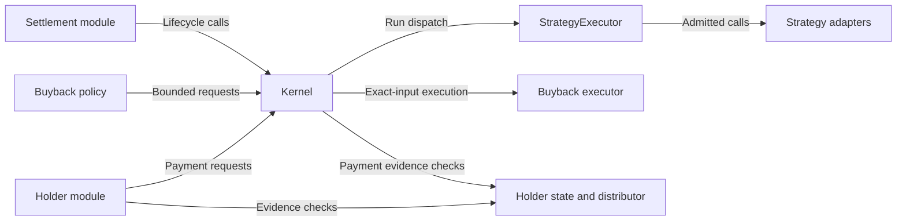

# COMPD — The Compounder

**Built to Compound.**

## Overview

COMPD is a modular treasury accounting and execution protocol being developed for **BNB Chain (chain ID 56)**. Its intended purpose is to separate treasury custody and accounting from strategy execution, settlement, buyback policy and holder-reward processing.

The system distinguishes available capital, outstanding strategy principal and purpose-specific reserves. An interface provides protocol presentation and optional observation data. Source-level responsibilities are described below; they do not establish deployment, active services or production qualification.

## Architecture Overview

The Kernel is the accounting and custody boundary. Settlement coordinates strategy lifecycle requests through the Kernel; StrategyExecutor dispatches to admitted adapters. Buyback and Holder modules request their dedicated Kernel operations, subject to policy, lifecycle and evidence checks.

Arrows show selected verified call relationships, **not token transfers or a complete dependency graph**. Evidence and liability components support the holder workflow; they are grouped or omitted here for clarity. The diagram does not describe an active deployment.

## How COMPD Works

1. **Fund and account.** Bootstrap funding and recognized native revenue are recorded in separate treasury and reserve buckets. Updating a bucket is an accounting operation; it is not a transfer to a holder, strategy or external wallet.
2. **Admit and allocate.** Strategy admission binds an adapter to reviewed commitments and runtime identity. Eligible run allocation records principal and sends native BNB through StrategyExecutor. Lifecycle, available-capital and exposure checks constrain new allocations.
3. **Exit and recover.** Settlement coordinates exit requests and bounded collection attempts. Partial recovery is credited from physical BNB balance changes, checked against the executor's report. A simulated or reported return alone is not settled capital.
4. **Close and settle.** Closure reconciles original principal with cumulative physical returns. The Kernel records realized profit or loss. Positive realized profit is allocated to strategy capital, buyback, holder-reward and protocol reserves; unrealized price movements are not treated as realized profit.
5. **Process dedicated reserves.** Buyback execution requires activation and bounded policy/route checks. Holder payments require verified fixed-recipient evidence and eligible reserve accounting, with explicit failure/retry handling. Reserve allocation does not prove that a buyback, burn or payout occurred.

These paths are implemented in the inspected source and exercised by local tests. Real venue behavior, finalized deployment identity, integration reliability and production operation require separate evidence. Source availability and operational validation are different milestones.

## Core Modules

| Module | Confirmed responsibility | Source component |
|---|---|---|
| Kernel / Treasury | Native BNB custody, bucket accounting, module permissions, lifecycle and allocation controls | `CompdVaultKernelV3` |
| StrategyExecutor | Adapter admission and typed strategy-run dispatch; records run identity and recovery state | `CompdStrategyExecutorV2R2`, used by the inspected V3 Kernel |
| Settlement | Start, exit, collection and closure coordination; run history and risk-breaker state | `CompdSettlementModuleV3` |
| Buyback | Bounded manual requests and activation-dependent execution from the dedicated reserve | `CompdBuybackPolicyModuleV3` and the Kernel-bound executor interface |
| Holder Rewards | Candidate review, canonical payment evidence, finalized distribution and payment/retry paths | `CompdHolderCandidateModuleV3`, `CompdCanonicalHolderStateV3`, `CompdHolderDistributorV3`, `CompdHolderModuleV3` |

Contract names identify source components, not verified deployed addresses. Historical versions and research prototypes are retained in the protocol repository and are not interchangeable with the documented graph.

## Security Considerations

- **Permission boundaries:** Kernel operations are restricted by module or administrative role. Permissionless collection and holder-payment paths remain constrained by run/evidence identity; callers do not gain arbitrary spending authority.
- **Accounting controls:** Custody checks, available-capital limits and physical-return reconciliation distinguish bookkeeping from asset movement. Reserve entries alone do not constitute transfers.
- **Execution controls:** Adapter admission commitments, runtime code-hash checks, lifecycle gates and allocation limits constrain execution. These controls do not guarantee profitability or eliminate loss.
- **Replay and failure handling:** Run/action identifiers, payment status and explicit retry state guard against repeated accounting or payment. Failure recovery is bounded by the relevant contract checks.
- **Operational boundary:** Credentials, private configuration and runtime state belong outside public source. Local fixtures and preparation scripts are not deployment instructions or authorization to trade.

This description is not an independent security audit or a production-readiness assessment. Code checks and local test results do not replace qualification of external dependencies, finality assumptions and operational procedures.

## Development Status

**The protocol and interface repositories are currently PRIVATE. Agent trading is NOT LIVE.**

The repositories contain implementation, tests and recorded evidence, but that does not establish a deployed or production-qualified COMPD graph. Reserved token addresses are not proof of token launch. Buyback, burn and holder-payment functionality must not be presented as active production services without corresponding verified evidence.

Public source release remains subject to first-party licensing approval, outstanding third-party redistribution/attribution questions and historical-privacy decisions. No unrestricted reuse license is implied. Third-party components retain their own terms. No verified profitability or autonomous trading performance is claimed.

## Repositories

| Repository | Scope | Current visibility |
|---|---|---|
| [compd-protocol](https://github.com/CompdProtocol/compd-protocol) | Contracts, Foundry tests, ABI exports and documented deployment evidence | **PRIVATE** |
| [compd-interface](https://github.com/CompdProtocol/compd-interface) | Frontend, architecture diagrams and observation/evidence API integration | **PRIVATE** |

These links are accessible only to authorized users while the repositories remain private. Their documentation distinguishes implementation status from deployed behavior.
