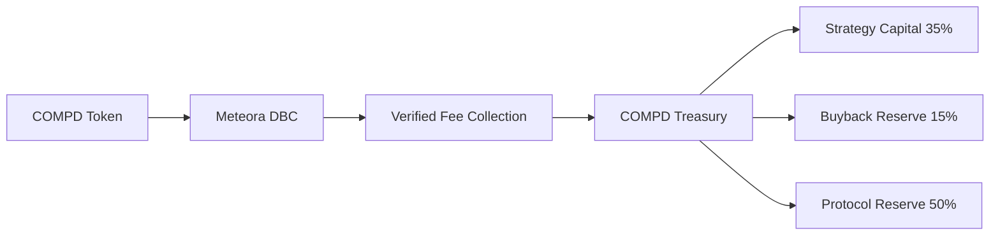

# COMPD Solana Mainnet architecture

**COMPD — The Compounder · Built to Compound.**

The selected launch path is **COMPD / SOL on Meteora Dynamic Bonding Curve**. Pool-level fee verification will separate the launch venue's fee settings from COMPD's internal treasury allocations.

Strategy settlement will recover principal before allocating positive realized profit: **65% Strategy / 15% Buyback / 10% Holder Rewards / 10% Protocol Reserve**. Receipt verification, custody, execution approvals and settlement are separate responsibilities. These logical components do not assert deployed Solana programs.

## Implementation scope

Solana Mainnet, Meteora DBC and COMPD / SOL define the current project direction. Preserved contracts and technical records retain their original meaning; they are not evidence of deployed Solana programs, an active DBC pool or live Agent trading. The original snapshot layout and trust-boundary record remain below for reproducibility.

Historical source snapshot architecture

# Architecture overview

COMPD is published as a monorepo with three isolated components.

## Interface — `apps/interface/`

Contains the browser UI and local Node.js server. It includes dashboard and evidence projections; these should not be treated as authoritative state. Admin presentation or wallet-message authentication does not, by itself, authorize transactions or prove backend authorization.

## Agent — `packages/agent/`

Contains observation, evaluation, and planning code, plus offline fixtures and tests. Publicly included source is not a turnkey trading service. Missing or stale inputs should remain unavailable; fixtures are not live prices, orders, fills, or transaction evidence.

## Protocol — `packages/protocol/`

Contains Solidity contracts, ABIs, and Foundry tests. Multiple contract generations and prototypes are retained. The presence of a `production` directory or deployment-address record does not prove current deployment, verification, route qualification, or safety.

## Trust boundaries

- The browser UI is a presentation layer, not a source of authorization.
- Agent observations and fixture data are not chain truth unless independently validated.
- Contracts can control assets when deployed; source-level tests do not replace independent audits and chain verification.
- Deployment, signer management, production secrets, and operational runbooks are intentionally outside this public bundle.

